# Table paragraph shading

These synthetic page renders compare main `b70c746f` with renderer code at `1051bb2f`.
The example is recorded separately by hash. Linux ARM64, Rust 1.99, bundled Source Sans 3,
400 x 200 pt pages, 2 px per pt. No Word-generated files or customer inputs are included.

Reproduce at either source revision with the same example:

```sh
cargo run -p wordcraft-render --example table_shading -- /tmp/table-shading
```

| Model/page | Before | After |
|---|---|---|
| spacing-1 | 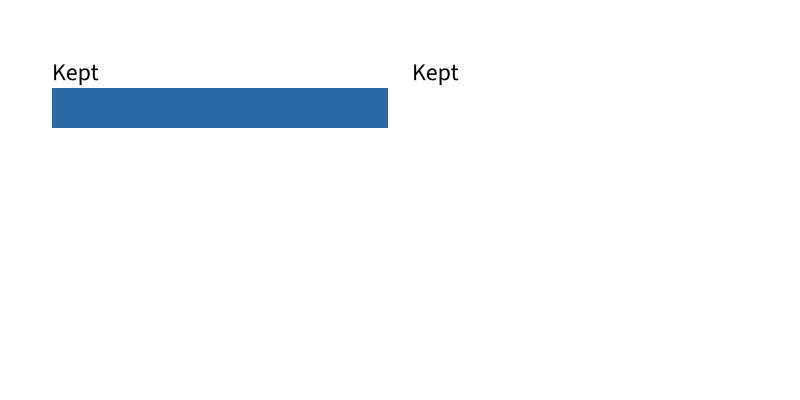 |  |
| spacing-2 | 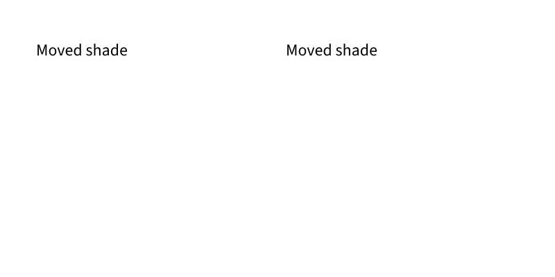 | 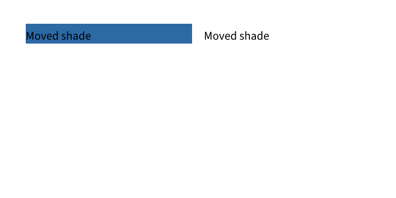 |
| widow-1 | 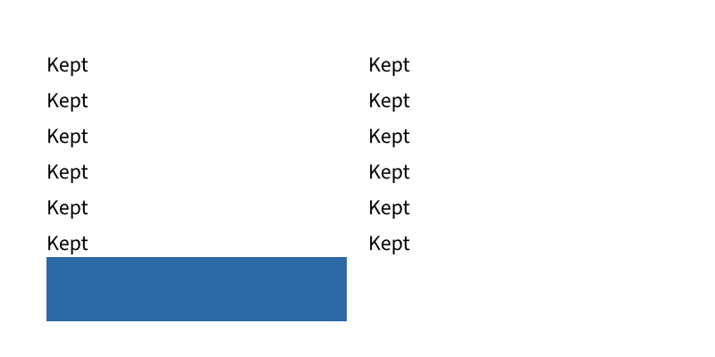 | 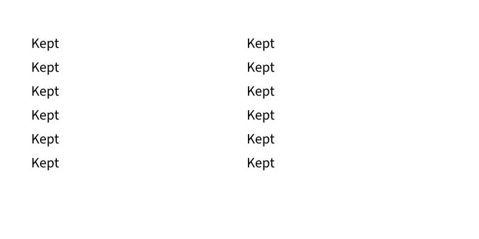 |
| widow-2 |  | 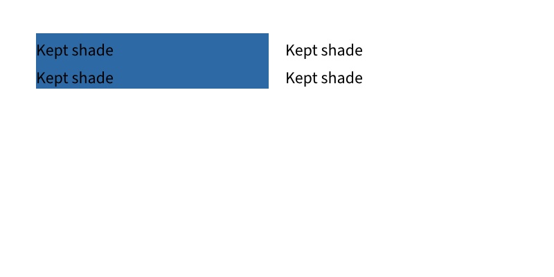 |
| partial-2 | 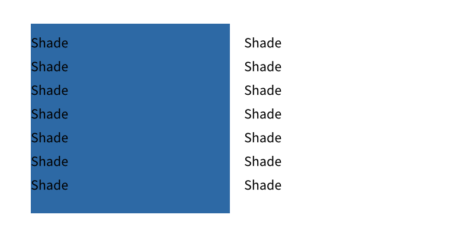 | 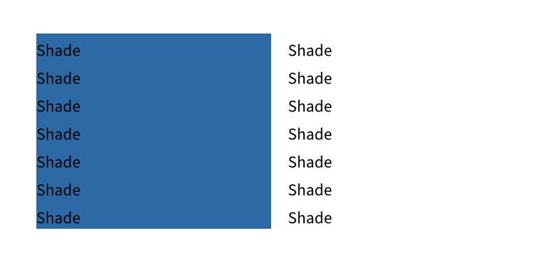 |
| closing-2 | 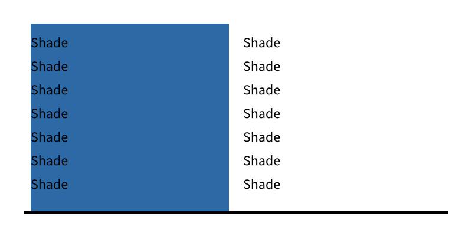 | 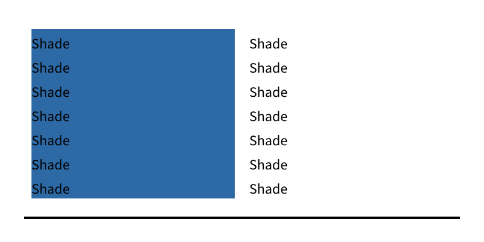 |
| cell-2 | 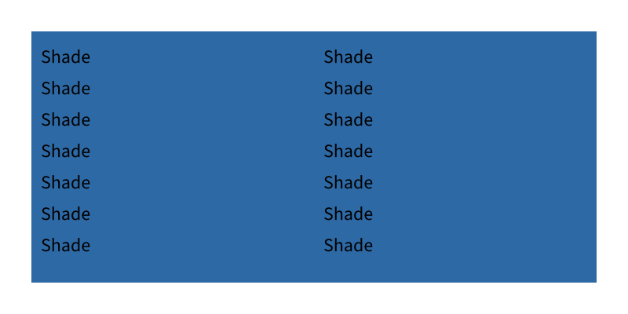 |  |
| equal-2 |  |  |

Spacing: shading leaves page 1 with its paragraph and follows it to page 2.
Widow: the kept shaded paragraph moves together. Partial: each continuation fill follows
its own line fragment. Closing: shading clears the cell margin and bottom rule.
Cell backgrounds and equal-colour cell/paragraph controls retain all three page PNGs
byte-for-byte. Only representative control pages are included here.

[renders.json](renders.json) binds the source, model, font and included PNGs.
This is paint evidence. It does not establish new native Word or general table parity.
